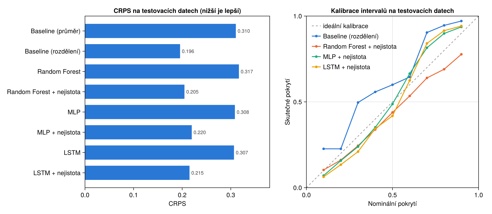
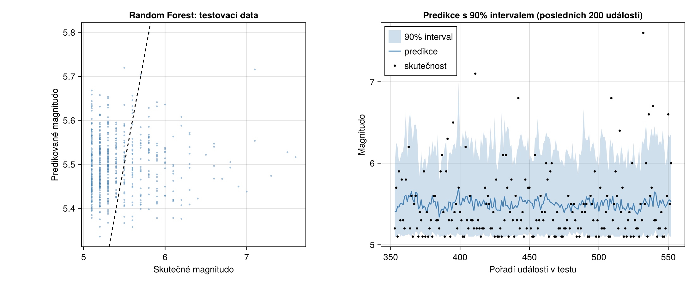
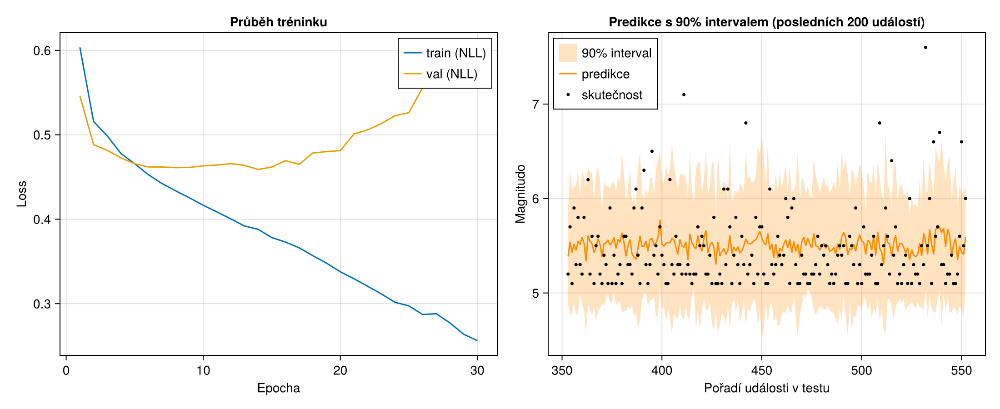
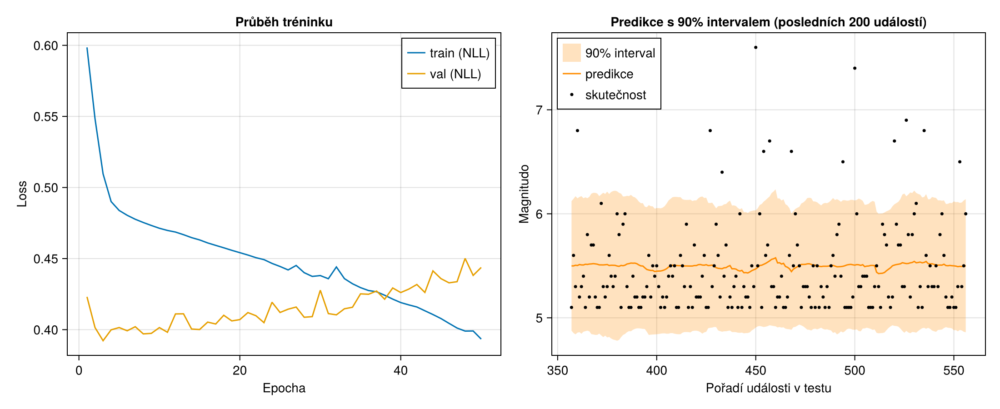

# Srovnání point-estimate a pravděpodobnostních modelů ve Flux.jl

## Zadání

Porovnat alespoň 3 metody strojového učení ve Flux.jl. Nejprve jako klasické
modely s bodovým odhadem (point-estimate), poté rozšířit vybrané z nich
o pravděpodobnostní výstup, který zahrnuje odhad nejistoty predikce.

## Požadavky

- Srovnat alespoň 3 metody a vybrané rozšířit o predikci nejistoty.
- Implementovat alespoň 3 metriky, na kterých se modely porovnají. Některé
  metriky dávají smysl jen pro point-estimate modely, jiné jen pro
  pravděpodobnostní.
- Ke vhodným metrikám zkusit i odpovídající loss funkce při tréninku (kde to
  dává smysl).
- Využít multiple dispatch při evaluaci, a to na typu výstupu modelu
  i na typu metriky.
- Udržet kód přehledný a modulární. Modely se skládají z existujících vrstev
  Flux.jl, takže důraz je na struktuře kódu a využití dispatche.

## Data a úloha

Data jsou katalog zemětřesení [USGS](https://earthquake.usgs.gov/fdsnws/event/1/)
pro oblast kolem Japonska (24–46° s. š., 122–148° v. d.) v letech 1990–2025.
Po vyčištění zůstanou jen zemětřesení s magnitudem **ostře větším než 5.0**.

Z každých `k = 10` po sobě jdoucích událostí (čas od předchozí události, poloha,
hloubka, magnitudo) se predikuje magnitudo následující události. Okna se tvoří
nad celým katalogem a teprve potom se chronologicky dělí na trénovací (70 %),
validační (15 %) a testovací (15 %) část.

## Modely a metriky

| Model | Bodový odhad | S nejistotou |
|---|---|---|
| `MeanBaseline` | průměr trénovacích magnitud | empirické rozdělení (`SampleHead`) |
| `RandomForest` | průměr stromů | predikce jednotlivých stromů (`SampleHead`) |
| `MLP` | MSE loss | normální rozdělení, NLL loss (`GaussianHead`) |
| `LSTMModel` (+ `TemporalAttention`) | MSE loss | normální rozdělení, NLL loss (`GaussianHead`) |

Metriky: `MAE`, `RMSE`, `CRPS`, `NLL` a `Coverage` (pokrytí intervalu).
`evaluate(metrika, predikce, y)` se vybírá podle typu metriky i typu predikce
(`PointPrediction`, `SamplePrediction`, `GaussianPrediction`). Pokud metrika
pro daný typ nedává smysl, vrací `missing`.

## Výsledky

Souhrn všech modelů na testovacích datech (`results/summary.txt`, `figures/summary.png`):

| Model | MAE | RMSE | CRPS | NLL | Pokrytí 90 % |
|---|---|---|---|---|---|
| Baseline (průměr) | 0.310 | 0.398 | 0.310 | – | – |
| Baseline (rozdělení) | 0.308 | 0.397 | **0.196** | – | 0.971 |
| Random Forest | 0.317 | 0.403 | 0.317 | – | – |
| Random Forest + nejistota | 0.317 | 0.403 | 0.205 | – | 0.777 |
| MLP | 0.308 | 0.404 | 0.308 | – | – |
| MLP + nejistota | 0.315 | 0.406 | 0.220 | 0.540 | 0.937 |
| LSTM | **0.307** | 0.397 | 0.307 | – | – |
| LSTM + nejistota | 0.313 | 0.399 | 0.215 | **0.500** | 0.942 |



- **Pravděpodobnostní predikce se vyplatí.** Všechny modely s nejistotou mají
  CRPS kolem 0.20–0.22, bodové kolem 0.31 (u bodové predikce je CRPS rovno MAE).
- **Kalibrace se liší.** MLP a LSTM s normálním rozdělením mají pokrytí 90%
  intervalu blízko nominální hodnoty (93–94 %). Random Forest má intervaly
  příliš úzké (78 %), protože rozptyl mezi stromy vyjadřuje jen nejistotu odhadu
  průměru, ne náhodnost samotného magnituda. Baseline má intervaly naopak
  zbytečně široké (97 %).
- **Žádný model nepřekonal baseline.** Nejnižší CRPS má rozdělení magnitud
  z trénovacích dat, které vstupní okno vůbec nepoužívá. Rozdíly v MAE mezi
  modely jsou v řádu tisícin. Z předchozích událostí se tedy modely nenaučily
  nic, co by predikci magnituda zlepšilo. Vysvětluje to Gutenbergův–Richterův zákon.

### Gutenbergův–Richterův zákon

Empirický zákon seismologie popisuje, kolik zemětřesení s magnitudem alespoň
`M` v dané oblasti nastane:

```
log10 N(≥ M) = a − b·M,      b ≈ 1
```

Zvýšení magnituda o 1 tedy znamená zhruba desetkrát méně událostí. Ekvivalentně:
magnitudo nad prahem `Mmin` má **exponenciální rozdělení** s parametrem
`β = b·ln 10 ≈ 2.3`, nezávisle na tom, co se dělo předtím. Velikost příštího
zemětřesení se podle současného poznání předpovědět nedá. Dá se předpovědět
spíš *kdy a kde* budou otřesy (např. dotřesy po velkém zemětřesení), ale
ne *jak silné*.

Na stažených datech zákon platí velmi přesně (3 681 událostí s M ≥ 5.1):

| M ≥ | 5.1 | 5.6 | 6.1 | 6.6 | 7.1 |
|---|---|---|---|---|---|
| počet událostí | 3681 | 1153 | 361 | 101 | 32 |

Každé zvýšení o 0.5 sníží počet asi 3.2× (= 10^0.5). Odhad metodou
maximální věrohodnosti (Aki–Utsu, s korekcí na zaokrouhlení na 0.1) dává
**b = 1.02**.

Zákon zároveň určuje, jaké nejlepší MAE lze čekat bez jakékoli informace
o vstupu: u exponenciálního rozdělení je střední absolutní odchylka od mediánu
`ln 2 / β ≈ 0.295`. Na datech vychází 0.296. Modely na testu dosahují MAE
0.307–0.317, tedy prakticky této teoretické hranice, a lepší být nemohou,
pokud magnitudo na minulých událostech nezávisí.

Projekt proto slouží hlavně jako srovnání metod a jejich odhadu nejistoty.
Úloha, kde by modely mohly baseline překonat, by měla jiný cíl, například
čas do další události nebo počet událostí v následujícím období. Na nich se
shlukování dotřesů projevuje.

### Grafy jednotlivých modelů

Vlevo je u sítí průběh tréninku (NLL na trénovacích a validačních datech),
u Random Forestu skutečné vs. predikované magnitudo. Vpravo je predikce
s 90% intervalem pro posledních 200 událostí testu.

**Random Forest**



**MLP**



**LSTM**



## Instalace

Je potřeba Julia 1.13 nebo novější.

```bash
git clone git@github.com:B0B36JUL-FinalProjects-2026/B0B36JUL-nohavond-2026.git
cd B0B36JUL-nohavond-2026
julia --project=. -e 'using Pkg; Pkg.instantiate()'
julia --project=scripts -e 'using Pkg; Pkg.instantiate()'
```

Balíček (`src/`) má vlastní prostředí v kořeni repozitáře. Skripty ve složce
`scripts/` mají navíc vlastní prostředí s balíčky pro grafy a ukládání
(CairoMakie, JLD2).

## Spuštění

Všechny příkazy se spouštějí z kořene repozitáře.

**1. Stažení dat** (uloží se do `data/japan_usgs.csv`, složka není v gitu):

```bash
julia --project=. scripts/download_data.jl
```

**2. Trénink jednotlivých modelů.** Každý skript natrénuje bodovou variantu
i variantu s nejistotou, vypíše tabulku metrik a uloží výsledky:

```bash
julia --project=scripts scripts/train_baseline.jl
julia --project=scripts scripts/train_forest.jl
julia --project=scripts scripts/train_mlp.jl
julia --project=scripts scripts/train_lstm.jl
```

**3. Souhrnné srovnání** všech natrénovaných modelů (tabulka obou částí dat,
graf CRPS a kalibrace intervalů):

```bash
julia --project=scripts scripts/compare.jl
```

Výstupy:

- `results/<model>.txt` a `results/summary.txt`: tabulky metrik,
- `results/<model>.jld2`: predikce na validačních a testovacích datech,
- `models/<model>.jld2`: natrénované modely, jen lokálně (složka není v gitu);
  neuronové sítě se ukládají jen jako `Flux.state` a parametry škálování
  (viz `model_state` a `load_state!`),
- `figures/*.png`: grafy.

Uloženou síť lze obnovit takto (hyperparametry musí odpovídat tréninku):

```julia
using EarthquakePredictionJapan, JLD2
saved = load("models/lstm.jld2", "gauss_model")
model = load_state!(LSTMModel(head = GaussianHead(), hidden = 64, dense = 32), saved)
```

## Použití z REPL

```julia
using EarthquakePredictionJapan

windows = make_windows(load_catalog(); k = 10)
data = chronological_split(windows)

model = fit!(MLP(head = GaussianHead()), data.train; val = data.val)
p = predict(model, data.test)
evaluate(CRPS(), p, data.test.y)
evaluate(Coverage(0.9), p, data.test.y)
```

## Testy

```julia
julia --project=. -e 'using Pkg; Pkg.test()'
```

Testy se spouštějí i automaticky na GitHubu po každém pushi (GitHub Actions).
Součástí testů je kontrola kvality balíčku pomocí [Aqua.jl](https://github.com/JuliaTesting/Aqua.jl).

## Struktura repozitáře

```
.
├── Project.toml                 závislosti balíčku
├── README.md
├── LICENSE
├── src/
│   ├── EarthquakePredictionJapan.jl   hlavní modul, exporty
│   ├── data/
│   │   ├── load.jl              načtení a vyčištění katalogu USGS
│   │   ├── windows.jl           klouzavá okna (WindowedData)
│   │   ├── split.jl             chronologické dělení train / val / test
│   │   └── scaling.jl           standardizace příznaků
│   ├── models/
│   │   ├── interface.jl         AbstractQuakeModel, hlavy (Point/Sample/GaussianHead)
│   │   ├── baseline.jl          MeanBaseline
│   │   ├── forest.jl            RandomForest
│   │   ├── network.jl           NetworkModel, NetworkState, ukládání sítí
│   │   ├── mlp.jl               MLP
│   │   ├── lstm.jl              LSTMModel
│   │   └── attention.jl         TemporalAttention
│   ├── predictions.jl           typy predikcí, point a interval
│   ├── metrics.jl               metriky a evaluate
│   ├── losses.jl                loss funkce pro jednotlivé hlavy
│   └── train_flux.jl            trénovací smyčka neuronových sítí
├── scripts/                     vlastní Project.toml (CairoMakie, JLD2)
│   ├── download_data.jl         stažení katalogu USGS
│   ├── common.jl                příprava dat, tabulky, ukládání
│   ├── plots.jl                 společné grafy
│   ├── train_baseline.jl
│   ├── train_forest.jl
│   ├── train_mlp.jl
│   ├── train_lstm.jl
│   └── compare.jl               souhrnné srovnání všech modelů
├── results/
│   ├── <model>.txt              tabulka metrik jednoho trénovacího skriptu
│   ├── <model>.jld2             predikce na val a testu (vstup pro compare.jl)
│   └── summary.txt              souhrnná tabulka všech modelů
├── figures/
│   ├── random_forest.png
│   ├── mlp.png
│   ├── lstm.png
│   └── summary.png              CRPS a kalibrace všech modelů
├── test/                        vlastní Project.toml
│   ├── runtests.jl
│   ├── test_data.jl
│   ├── test_models.jl
│   └── data/sample_usgs.csv     malý vzorek katalogu pro testy
├── .github/workflows/CI.yml     testy na GitHub Actions
├── data/                        stažený katalog (jen lokálně, není v gitu)
└── models/                      natrénované modely (jen lokálně, není v gitu)
```

## Licence

Viz soubor [LICENSE](LICENSE).
